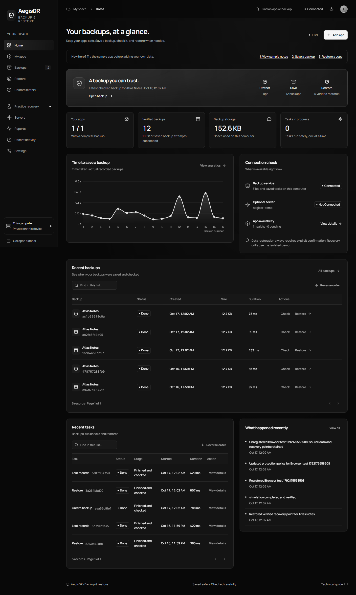
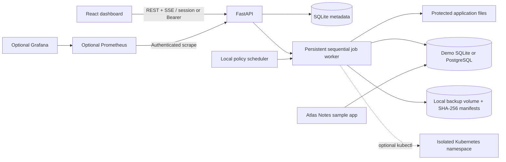

# AegisDR

**New here?** Read the [simple getting-started guide](docs/getting-started.md). It explains how to open the app, save a backup, and restore sample notes without needing cloud or database experience.

The dashboard now uses a black-and-white theme, clearer navigation, optional reduced movement, saved display preferences, and lighter background refresh. Technical setup details remain below.

**Automated Cloud Disaster Recovery & Backup Platform**

A locally runnable recovery workbench with a React dashboard, real file and database backups, checksum verification, scheduling, retention and isolated disaster drills. The default native setup uses a disposable SQLite notes database; Docker Compose uses PostgreSQL with real `pg_dump` / `pg_restore`. No cloud account, paid service or API key is required.



## Architecture



React 19, TypeScript, Vite, Tailwind CSS, React Router, Framer Motion, Lucide, Recharts and TanStack Query power the dashboard. FastAPI, Pydantic, SQLAlchemy and SQLite store application configuration, jobs and audit events. Python `tarfile`, SQLite's consistent backup API, PostgreSQL client tools, and `kubectl` execute actual operations. Kustomize defines the optional namespace and workloads. Prometheus and Grafana are optional, free local services.

## Start locally

To run the whole app on Kubernetes on your computer, use `.\scripts\start-kubernetes.ps1`. See the [local Kubernetes guide](docs/local-kubernetes.md) for updating, stopping, and checking it.

For automatic Kubernetes releases, see the [Kubernetes deployment guide](docs/kubernetes-deployment.md). CI tests the deployment on a disposable cluster and publishes successful main-branch builds; cloud rollout requires a connected cluster and HTTPS hostname.

### One-command Docker Compose

Prerequisites: Docker Engine/Desktop **running**, Docker Compose v2 and available ports 8088/8001. From this directory:

```sh
docker compose up --build
```

- Dashboard and API: **http://127.0.0.1:8088**
- API docs: http://127.0.0.1:8088/docs
- Standalone Atlas Notes sample: http://127.0.0.1:8001

The platform container serves the compiled frontend and backend from one origin. PostgreSQL, Atlas Notes and a one-shot secret initializer are separate services. Application metadata, backup storage and PostgreSQL use persistent Docker named volumes. Secrets are generated on first run in a private named volume and preserved on later runs; no password is hardcoded in source. Ports bind to loopback only. The backup store is a local filesystem volume, the supported local equivalent to object storage; S3/MinIO is not required or implemented.

Stop with `docker compose down`. **Do not add `--volumes` unless you intend to erase all local demo data, backup history and generated secrets.** No setup script automatically removes volumes or a cluster.

### Native Windows (Docker not required)

Prerequisites: Python 3.11+ and Node.js 22.12+ (24 recommended). No PostgreSQL installation is needed for the default SQLite demo.

```powershell
.\scripts\start.ps1
```

This installs dependencies into `.venv`, builds the frontend, and runs the full platform at **http://127.0.0.1:8088**. Stop with Ctrl+C. Unix equivalent: `sh scripts/start.sh`.

For development with hot reload, run these in separate terminals:

```powershell
.\.venv\Scripts\python.exe -m uvicorn backend.main:app --host 127.0.0.1 --port 8000 --no-proxy-headers
```

```powershell
cd frontend
npm ci
npm run dev
```

Development dashboard: **http://127.0.0.1:5173**. Vite proxies `/api`, `/docs`, `/openapi.json` and `/health` to the backend.

### Native PostgreSQL

Use a **dedicated disposable database**, PostgreSQL client binaries on PATH, and a fresh data directory when switching the demo engine:

```powershell
$env:AEGIS_DATA_DIR='.data/postgres-demo'
$env:AEGIS_POSTGRES_ENV='AEGIS_DB_DEMO'
# Set AEGIS_DB_DEMO in this process to your locally managed database DSN.
# Do not paste it into source files or use an existing important database.
.\scripts\start.ps1
```

The server must be reachable before platform startup. `pg_dump` must be at least as new as the server's major version; Compose aligns both at PostgreSQL 17. Database credentials travel in subprocess environment variables, never password-bearing command arguments. The demo database schema is seeded once, when the demo application is first created. An empty dataset after startup is real, and is not silently reseeded.

## What works

| Capability | Native core | Compose | Kubernetes |
| --- | --- | --- | --- |
| All dashboard routes, search/filter/pagination, themes | Yes | Yes | No cluster needed |
| Application registration, policy management, audit persistence | Yes | Yes | No cluster needed |
| Consistent SQLite demo snapshots | Default | Optional | No cluster needed |
| PostgreSQL logical dump and transactional restore | With configured DB/client | Default | With DB port-forward/client |
| Persistent file archives, integrity checks, restoration | Yes | Yes | Files must be mounted into protected root |
| Interval scheduling, retention, pre-restore safety backup | Yes | Yes | Runs in platform process |
| Data-loss and corruption drills | Yes | Yes | No cluster needed |
| Deployment/pod/service/ConfigMap discovery | Unavailable until connected | Unavailable until configured | Scoped namespace |
| Pod failure and replica disruption drills | Requires cluster | Requires cluster configuration | Managed demo only |
| Managed configuration snapshots/reapply | Requires cluster | Requires cluster configuration | Deployment/Service/ConfigMap |
| Automatic recovery | Health alerts locally | Health alerts locally | Opt-in demo replica recovery |
| Metrics and RPO/RTO views | Actual local data | Actual local data | Additional workload health |

The application exposes `/`, `/applications`, `/applications/:id`, `/backups`, `/backups/:id`, `/recovery`, `/recovery/history`, `/simulations`, `/clusters`, `/monitoring`, `/activity`, `/settings`, and a custom fallback route. Settings exposes mutable protection policies; environment-dependent system settings are accurately shown as runtime configuration.

## Backup and restore walkthrough

1. Open **Applications → Atlas Notes**. Add a note; this writes a record into the actual demo database.
2. Optionally modify `.data/protected/demo/welcome.txt` or add files in that directory (native mode).
3. Click **Back up now**. Inspect the persisted execution timeline under the application or Overview.
4. Open the completed recovery point. Review `files.tar.gz`, the database payload, sizes, timestamps and SHA-256 hashes. Download its actual manifest or run a new verification job.
5. Add another note or modify a file after the snapshot.
6. Select **Restore**, review the source and database overwrite scope, and type the exact `RESTORE Atlas Notes` phrase. Kubernetes reapply is separately opt-in when a snapshot exists.
7. The worker first creates an independent safety recovery point, verifies the selected backup, restores files/database and checks the restored files plus database connectivity. Inspect **Restore history** for stages, measured duration, errors and the safety backup ID.
8. Confirm the dataset matches the selected recovery point. The pre-restore safety point remains available to recover later changes.

Register another application with a subdirectory beneath `.data/protected/`. Existing files are preserved and overlapping source trees are rejected. PostgreSQL registration uses the **name** of an `AEGIS_DB_*` backend environment variable. Passwords and URLs never belong in the registration form. Unregistering preserves files and backup records, but restoration to that removed application is unavailable; register and configure the intended application before creating new recovery points.

### Scheduling and retention

Policies define an interval in minutes, retained point count, RPO/RTO targets, and repeated health failure threshold. The scheduler checks policies every five seconds while the backend is running. It persists the last scheduled time, prevents duplicate pending backup jobs, and schedules a due backup after restart rather than replaying all missed intervals. Pausing scheduling does not disable manual backups.

Retention runs after successful scheduled/manual backups and expires older complete points beyond the configured count, preserving recovery points referenced by active jobs. Failed and corrupted evidence is retained for investigation. Safety and simulation points are retained immediately and participate in later retention evaluation. The default is 10 complete recovery points. Retention is count-based; expiry metadata remains in the audit history. GitHub Actions never performs recurring backups.

## Disaster simulation walkthrough

**Practice recovery** lists preconditions and requires `DISRUPT DEMO` confirmation.

- **Database data loss:** require at least one demo note; create a verified backup, delete actual notes, observe zero records, restore, then compare every record with the original dataset. A failed drill attempts best-effort restoration from its new point.
- **Backup corruption:** make an isolated temporary copy, append corrupt bytes, require checksum failure, discard the copy, and reverify the original. The valid recovery point is preserved.
- **Pod failure:** delete a labeled demo pod, observe a different pod UID become Ready, record elapsed time. This is explicitly **Kubernetes self-healing**.
- **Application failure:** temporarily set the managed demo's replicas to zero, verify the replica state, restore its previous replica target in a `finally` block, then verify availability. This is replica recovery, not a database restore.

Each execution persists start/end times, stages, errors, outcome and measured duration. Simulation results are excluded from observed production restore RTO. In-flight jobs are sequential; queued jobs can be cancelled. Running restores cannot be cancelled mid-write.

## Optional local Kubernetes

Prerequisites: a running Docker daemon, `kind`, `kubectl`, and Python. This explicitly creates a **local** `kind-aegisdr` cluster; it does not access a remote cluster.

```powershell
.\scripts\kind-up.ps1
```

The script builds/loads the demo image, creates `aegisdr-demo`, generates a database Secret without logging it, applies Kustomize resources, waits for readiness, and writes an ignored operator kubeconfig. It pins every setup command to `--context kind-aegisdr`.

Run the backend with:

```powershell
$env:KUBECONFIG=(Resolve-Path '.data/operator-kubeconfig.json').Path
$env:AEGIS_KUBE_ENABLED='true'
.\scripts\start.ps1
```

This enables discovery, pod/replica drills and metadata snapshots for the local Atlas Notes application. To also protect **the cluster's database**, port-forward `service/demo-postgres` to a free loopback port using the administrative `kind-aegisdr` context, obtain the generated database Secret privately, set the local `AEGIS_DB_DEMO` DSN, set `AEGIS_POSTGRES_ENV`, and use a fresh metadata directory as described above. The namespace's PostgreSQL data and native SQLite demo are distinct databases until this connection is configured.

The generated service-account token lasts 24 hours; rerun `python scripts/operator-config.py` using the administrative context to refresh. The Role grants namespace discovery and managed-resource recovery operations, not cluster administration or Secret reads. Kubernetes RBAC cannot enforce label selectors, so this namespace must remain **dedicated to disposable demo resources**. Runtime mutation additionally requires the `aegisdr.io/managed=true` label. No production namespace is a safe target for this demo operator.

Metadata snapshots include supported labeled Deployments, Services and ConfigMaps, excluding resource status, server identifiers and Secrets. PVCs are provisioned by Kustomize but are **not** block-level snapshots. For persistent file backup, mount the supported application's files under the protected root; arbitrary cluster PVC snapshotting and CSI integration are not implemented.

## Monitoring

The dashboard's metrics come from persisted operations. No historical points are seeded. Backup storage, execution duration and success rates represent currently stored metadata; the success rate explicitly describes **retained complete vs failed/corrupted** points, not a lifetime SLA. Protected means at least one complete recovery point exists, even if scheduled protection is paused.

RPO is the age of the latest complete recovery point, compared with its policy target. Observed RTO is the latest verified restore/replica job's execution duration; it excludes human detection and approval time. Missing observations remain **Not measured**. Kubernetes health remains unavailable when integration is disabled or unreachable.

Optional metrics stack:

```sh
docker compose --profile monitoring up --build
```

Prometheus: http://127.0.0.1:9090. Grafana: http://127.0.0.1:3000, username `operator`. Its generated password is stored in the private Compose secrets volume; an authorized local operator can retrieve it with `docker compose exec grafana cat /run/aegis-secrets/grafana-password`. Grafana provisions the data source and actual-observation dashboard. The scrape endpoint `/metrics` requires the generated API token; Prometheus reads it from a mounted secret file. The dashboard uses authenticated SSE with five-second query polling as fallback.

## Security and operational boundaries

- Local mode grants an HttpOnly SameSite=Strict session only to loopback peers, allowed origins and recognized local Host headers. Compose explicitly enables `AEGIS_CONTAINER_LOCAL_SESSION` to also accept private Docker bridge peers, because NAT obscures the loopback address; its published port is bound exclusively to loopback. Never enable this option on a publicly accessible listener. Default native and Compose listeners bind to loopback. The API requires that session or a Bearer token for data access and all sensitive operations. Browser writes validate Origin.
- For remote access set `AEGIS_LOCAL_MODE=false`, configure `AEGIS_API_TOKEN` or `AEGIS_API_TOKEN_FILE` with at least 32 random characters, explicitly set allowed origins, provide TLS and restrict network access. The connection screen accepts a token into sessionStorage. This is single-operator authorization, **not multi-user enterprise IAM**. Never expose local-mode session bootstrap through a public reverse proxy.
- Environment variables or secret files contain database credentials. `.data`, `.env`, local tokens and kubeconfigs are ignored. No credentials are baked into repository files.
- Filesystem sources must stay below the protected root; unsafe source IDs, traversal, links, archive entry types, and overlapping sources are rejected. Archives are verified against an independently persisted manifest before extraction.
- Backups are not encrypted; keep the local volume private. SHA-256 detects corruption but does not defend against an attacker who can rewrite both payloads and metadata. This is not an immutable or geographically separate backup store.
- PostgreSQL restores use a single transaction. File trees are staged before replacement with rollback on replacement failure. Files, database and Kubernetes changes do **not** form one distributed transaction; the retained pre-restore safety point supports manual recovery after partial failure. Quiesce external writers for cross-file/database consistency. The worker serializes native demo operations but cannot pause unrelated applications.
- Run **exactly one backend worker/process** per metadata store. This durable local worker does not provide distributed leases. Running jobs are marked failed on restart; queued jobs are preserved. PostgreSQL/kubectl subprocesses have timeouts; file archives check a deadline while traversing; hashing/extraction and individual large-file I/O do not have preemptive cancellation.
- Automatic recovery is opt-in, retries health checks, and only restores a zero-replica **isolated demo** deployment to one replica. It never automatically restores databases. Transient failure does not authorize data replacement.
- Audit events and structured logs persist outcomes. Demo files, backups and databases remain after stopping. Do not use critical data in deliberate disaster drills.

See [.env.example](.env.example) for all principal settings and [docs/verification.md](docs/verification.md) for actual validation evidence and environmental limitations.

## Tests and CI

```powershell
.\.venv\Scripts\python.exe -m pytest
.\.venv\Scripts\python.exe -m ruff check backend demo-app scripts automation
.\.venv\Scripts\python.exe scripts/validate-infrastructure.py
docker compose config --quiet
kubectl kustomize infrastructure/kubernetes
cd frontend
npm run lint
npm test
npm run build
npx playwright install chromium
# Start the development backend and frontend first:
npm run test:e2e
```

The PostgreSQL integration test runs only when `AEGIS_TEST_POSTGRES_URL` names a dedicated disposable database; it deliberately restores and mutates its `notes` table. Never point it at an important database. All other backend tests use isolated temporary directories. Browser tests use the local disposable Atlas Notes demo and create real recovery points and drills.

`.github/workflows/ci.yml` prepares frontend lint/tests/build/audit, backend tests including PostgreSQL recovery, Python dependency audit, Playwright browser checks, Docker image builds, Compose validation, Kustomize rendering and strict Kubernetes schemas. These are local workflow definitions; remote runs require a GitHub repository and the configured push/PR/manual trigger. No workflow was remotely executed, and CI is not an always-on recovery service.

## Design provenance

Reviewed [rdev/liquid-glass-react](https://github.com/rdev/liquid-glass-react), its [MIT license](https://github.com/rdev/liquid-glass-react/blob/master/LICENSE), package metadata and documented Safari/Firefox limitations. React compatibility and runtime dependencies were inspected. This operational UI uses original CSS frosted surfaces, highlights and backdrop blur with readable solid fallbacks rather than importing the displacement component. Manrope is bundled locally via Fontsource; no runtime font CDN is needed.

## Limitations and next steps

The supported core is local filesystem storage, logical database backups and a dedicated single namespace. Docker and Kubernetes execution require their services to be available. No S3/MinIO adapter, Velero/Restic/Kopia integration, CSI/block snapshots, cross-region replication, multi-user RBAC, high-availability scheduler, multi-process coordination, encrypted storage, or untrusted-backup sandbox is claimed. Retention of corrupted/failed evidence needs manual operator review. Large deployments need a dedicated queue, streaming archive verification, authenticated notifications, distributed locking and off-machine storage. The dashboard's job/event list APIs return the latest 500/1000 entries respectively; full audit export is a future improvement.

No Git commits, pushes, pull requests, remote publications or remote deployments are part of this implementation.
